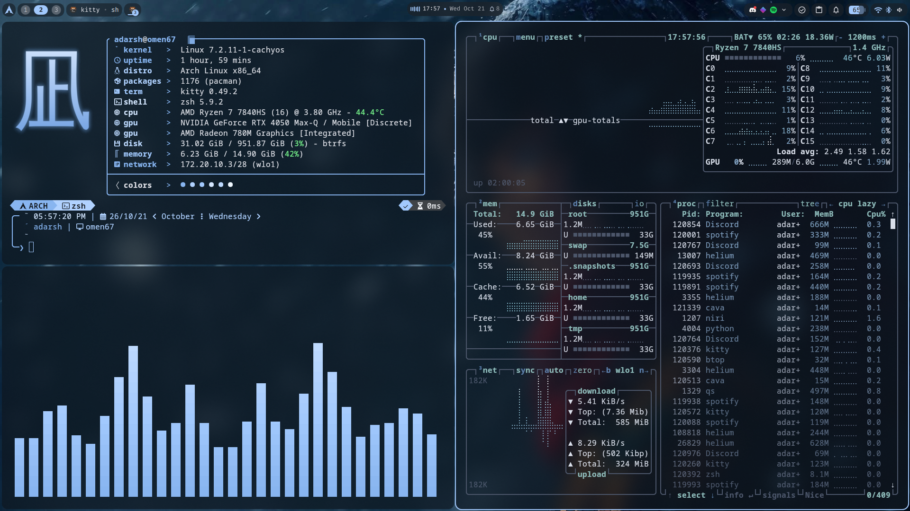
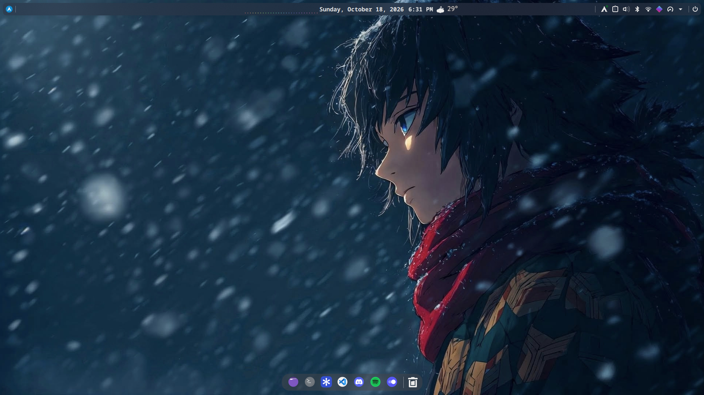
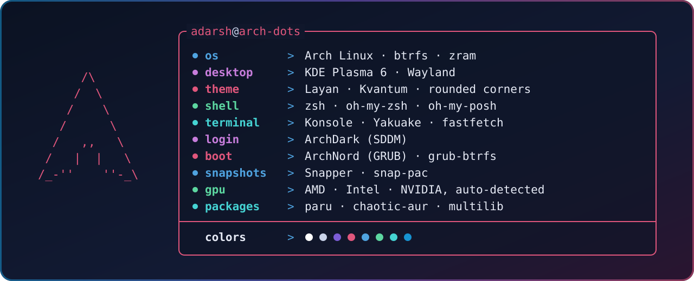

<div align="center">



<br>


<br>



<br><br>



</div>

<br>

## 🌌 Setup at a glance

<div align="center">



</div>

<br>

## ⚡ Install

> [!NOTE]
> Start from a fresh `archinstall`. From the Arch ISO, this presets **GRUB**, **Minimal** profile, pipewire, NetworkManager, zram, multilib and `git`:
>
> ```sh
> archinstall --config https://raw.githubusercontent.com/adarsh-67r/arch-dots/main/archinstall.json
> ```
>
> You still pick the disk (**btrfs**, default subvolumes, **Snapper** snapshots), user and password. Change `timezone` / keyboard in the menu if you're not in India.

Reboot, log in on the TTY, then:

```sh
git clone https://github.com/adarsh-67r/arch-dots
cd arch-dots
./install.sh
```

Reboot, and you're riced. Then set your station in the weather widget.

<br>

<details>
<summary>&nbsp;🛠️ <b>What <code>install.sh</code> does</b></summary>
<br>

- Tweaks pacman: Color, ILoveCandy, VerbosePkgLists, 5 parallel downloads
- Adds chaotic-aur and multilib
- Installs everything in `packages/`, then GPU drivers for your hardware
- Sets up Snapper, snap-pac and grub-btrfs: every update is snapshotted and bootable
- Copies dotfiles, wallpapers, scripts and system configs
- Installs the ArchDark and ArchNord themes
- Enables services, and asks for your sudo password only once

</details>

<details>
<summary>&nbsp;🗂️ <b>Repo layout</b></summary>
<br>

```
arch-dots/
├── install.sh            install (or `./install.sh save` to update the repo)
├── packages/             pacman.txt, aur.txt
├── dotfiles/
│   ├── shell/            zsh, oh-my-posh, fastfetch, bat
│   ├── kde/              Plasma, KWin, Kvantum, Konsole, widgets
│   └── apps/             btop, cava, htop, topgrade
├── system/               /etc configs: zram, snapper, Wi-Fi, keyboard
├── hardware/omen-8bcd/   HP OMEN 16 fixes (applied only on that board)
├── themes/               sddm/ArchDark, grub/ArchNord
├── scripts/              upd, keyfix, rpipe
├── wallpapers/
└── assets/               screenshots
```

</details>

<details>
<summary>&nbsp;🧰 <b>Scripts</b></summary>
<br>

| Command | Does |
|---|---|
| `upd` | Update packages, AUR, Flatpaks, Rust and firmware |
| `keyfix` | Rebuild the pacman keyring |
| `rpipe` | Restart PipeWire when audio breaks |

</details>

<details>
<summary>&nbsp;🔄 <b>Keep it updated</b></summary>
<br>

```sh
./install.sh save
git diff
git commit -am "update" && git push
```

</details>

<details>
<summary>&nbsp;💻 <b>HP OMEN 16 (board 8BCD)</b></summary>
<br>

Applied automatically on that board only:
- NVIDIA s2idle fix so the laptop wakes from sleep
- KWin and SDDM on the AMD iGPU so the RTX 4050 can power off
- `hdmi-mode on|off` to switch HDMI output (wired to the NVIDIA GPU)

</details>

## 📜 License

[MIT](LICENSE) for my scripts and configs. Third-party themes and widgets keep their own licenses.

<br>


