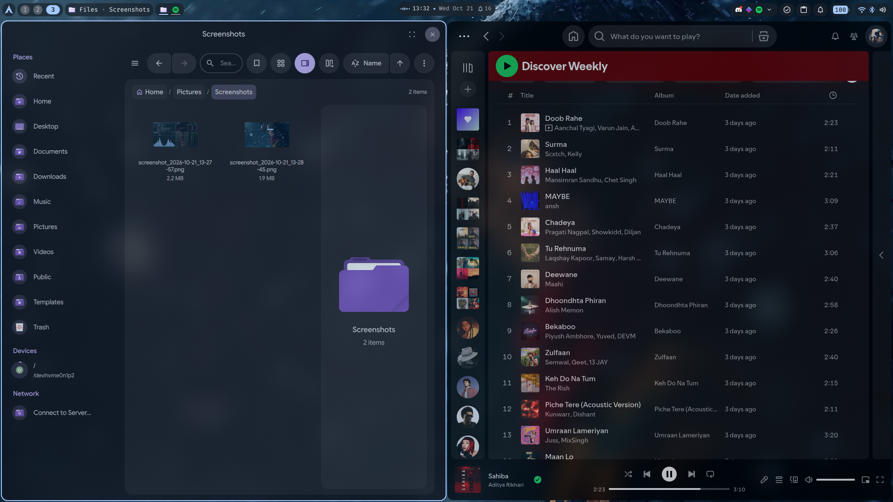
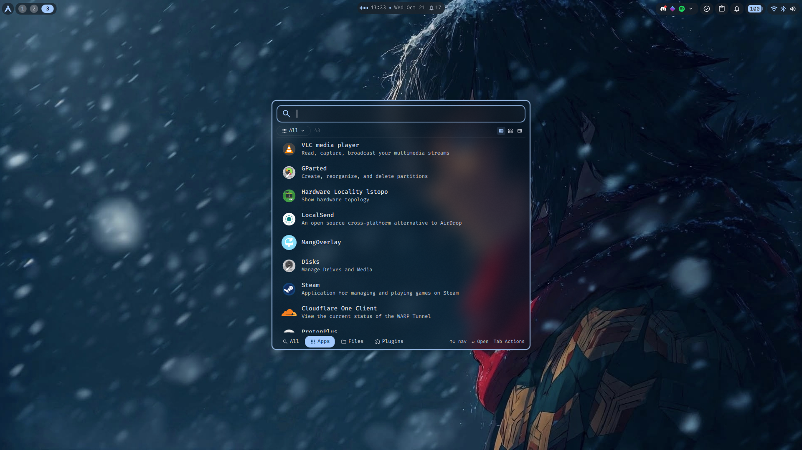
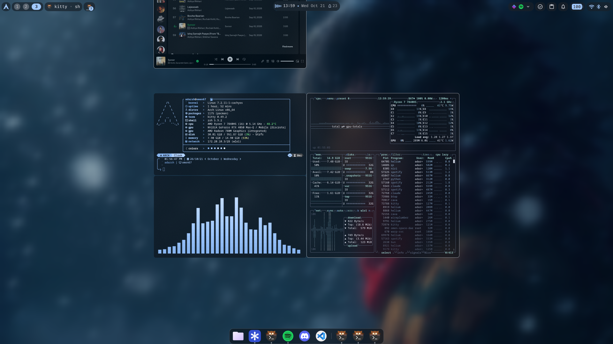
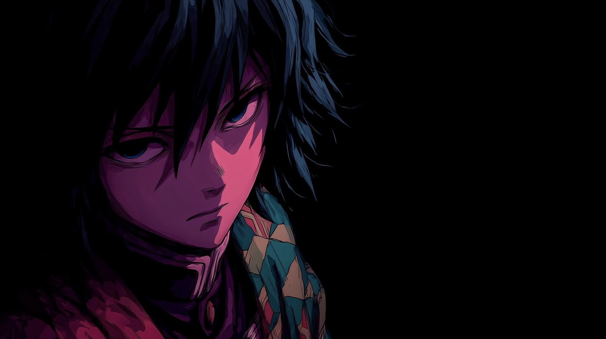

<div align="center">


<br><br>


<br>


<br>


<br><br>


<br><br>

<details>
<summary>&nbsp;📸 <b>More screenshots</b></summary>
<br>


<br><br>

<br><br>


</details>

</div>


<br>

<div align="center">

<p><i>For the record, Giyu is <b>not</b> hated. He just never explains anything.<br>
This README explains things for him.</i></p>
</div>

<br>

## 壱ノ型 · At a glance
<sub>水面斬り · Water Surface Slash</sub>

<div align="center">


</div>

<br>

## 弐ノ型 · Install
<sub>水車 · Water Wheel</sub>

**1. Base system.** Boot the Arch ISO and run archinstall with nagi's preset (GRUB, Minimal profile, PipeWire, NetworkManager, zram, multilib, `git`):

```sh
archinstall --config https://raw.githubusercontent.com/adarsh-67r/nagi/main/archinstall.json
```

You still pick the disk (**btrfs**, default subvolumes, **Snapper** snapshots), user and password. The preset's timezone and keyboard are for India, so change them in the menu if that's not you.

**2. nagi.** Reboot, log in on the TTY, then:

```sh
curl -fsSL https://raw.githubusercontent.com/adarsh-67r/nagi/main/setup.sh | bash
```

It clones nagi to `~/nagi` and opens the setup menu. Every row shows its current value; open one to change it, then **Start installation**:

```
  1. Apps                │ 13 selected
  2. Look                │ nagi glass
  3. Kernel              │ CachyOS + LTS
  4. Graphics driver     │ auto-detect: AMD + NVIDIA
  5. Parallel downloads  │ 5
  6. Cloudflare WARP     │ yes
  7. Start installation
```

| Row | Choices |
|---|---|
| Apps | Checklists per category: browsers, chat, development, media, office, creative, utilities. My apps start ticked; untick them or add others: Firefox, Zen, Vivaldi, LibreWolf, Chromium, Vesktop, Telegram, LibreOffice, Obsidian, GIMP, Krita… |
| Look | **nagi glass**: my configs, with transparency and blur on the bar, popups, windows and kitty. **Dux defaults**: Dux's own solid configs, no blur. Either way you get the same wallpaper colors, GTK/Qt theming and fonts, and `nagi-update` keeps to what you picked |
| Kernel | CachyOS + LTS (booted by default), CachyOS only, or Stock: the kernel archinstall set up |
| Graphics driver | Auto-detect, or pick your setup: Intel, AMD, NVIDIA Turing+ or legacy (GTX 900/1000), hybrid laptops (Intel or AMD iGPU + NVIDIA or AMD dGPU), or a virtual machine |
| Parallel downloads | How many packages pacman fetches at once |
| Cloudflare WARP | The WARP VPN client and its service |

You get a summary before anything installs. To skip the menu and take the defaults, add `-s -- --all` after `bash`. To see what a setup would install without installing anything, run `./install.sh --dry-run` from `~/nagi`.

The [Dux installer](https://duxlabs.dev) runs next. Pick **niri** when it asks.

**3. Reboot.** On first login Giyu is already on the wallpaper, and the colors follow. Everything the installer printed is in `~/nagi-install.log`.

<br>

## 参ノ型 · Keybindings
<sub>流流舞い · Flowing Dance</sub>

niri lays windows out as columns on an endless strip that scrolls sideways; you flow along it instead of juggling tiles. `Mod` is the Super (Windows) key.

| Keys | Does |
|---|---|
| `Mod` `Return` / `Mod` `T` | Terminal (kitty) |
| `Mod` `Space` | App launcher |
| `Mod` `Q` | Close window |
| `Mod` `H` `J` `K` `L` or arrows | Move focus |
| `Mod` `Shift` + `H` `J` `K` `L` | Move the window or column |
| `Mod` `1`…`9` / `Mod` `Shift` `1`…`9` | Go to workspace / send the column there |
| `Mod` `R` · `Mod` `F` · `Mod` `Shift` `F` | Cycle column width · maximize · fullscreen |
| `Mod` `O` / `Mod` `Tab` | Overview |
| `Mod` `D` · `Mod` `A` | Dash · Control Center |
| `Mod` `V` | Clipboard history |
| `Mod` `Y` | Browse wallpapers |
| `Print` | Screenshot a region (`Ctrl` full screen, `Alt` window) |
| `Mod` `Alt` `L` | Lock |
| `Mod` `Shift` `/` | **Every** shortcut |

<br>

## 肆ノ型 · Commands
<sub>打ち潮 · Striking Tide</sub>

| Command | Does |
|---|---|
| `upd` | Update the system: packages, AUR, Flatpaks, Rust and firmware |
| `nagi-update` | Update nagi itself ([details](#漆ノ型--updating)) |
| `steam-aio` | Install Steam and gaming tools ([details](#伍ノ型--gaming)) |
| `rpipe` | Restart PipeWire when audio breaks |

<br>

## 伍ノ型 · Gaming
<sub>干天の慈雨 · Blessed Rain After the Drought</sub>

Gaming is left out of the install on purpose. When you want it, one command brings it all:

```sh
steam-aio
```

That's Steam, gamescope, MangoHud, ProtonPlus, Wine with the 32-bit libraries Proton games need, and gamemode. It also adds you to the `gamemode` and `realtime` groups, so log out and back in afterwards.

Handy Steam launch options: `gamemoderun %command%`, `mangohud %command%`, and on a hybrid-GPU laptop `prime-run %command%` to run on the dedicated GPU.

<br>

## 陸ノ型 · Wallpapers & colors
<sub>ねじれ渦 · Whirlpool</sub>

<div align="center">


</div>

Everything is pulled around the wallpaper. Pick one with `Mod` `Y` and the bar, GTK apps, kitty, fastfetch, the zsh prompt and VS Code all re-color from it (Material You, via matugen). Dux's templates also cover apps you can pick in the installer, like Vesktop, Zed, Firefox and Zen. The snow one is the default.

<br>

## 漆ノ型 · Updating
<sub>雫波紋突き · Drop Ripple Thrust</sub>

One change, pushed once, ripples out to every machine running nagi. Two separate updates, two commands:

| Command | Updates |
|---|---|
| `upd` | The system: packages, AUR, Flatpaks, Rust and firmware |
| `nagi-update` | nagi itself: pulls this repo, installs packages new to the lists, re-applies configs, scripts and wallpapers. It never upgrades what's already installed, and it lists any configs you changed locally before overwriting them |

Changed something on your machine and want it in the repo? Save it, then push:

```sh
cd ~/nagi
./install.sh save
git diff
git commit -am "update" && git push
```

<br>

## 捌ノ型 · How it works
<sub>滝壷 · Waterfall Basin</sub>

<details>
<summary>&nbsp;🛠️ <b>What <code>install.sh</code> does</b></summary>
<br>

1. Tweaks pacman (Color, ILoveCandy, VerbosePkgLists, 5 parallel downloads) and builds AUR packages on all CPU cores
2. Adds chaotic-aur and multilib
3. Opens the setup menu (apps, look, kernel, GPU driver, downloads, WARP), then logs everything to `~/nagi-install.log`
4. Runs the Dux installer: niri, Dux Shell, greetd + dms-greeter
5. Installs everything in `packages/`, then the GPU drivers your hardware needs
6. Sets up Snapper, snap-pac and grub-btrfs, so every update is snapshotted and bootable
7. Copies dotfiles over the Dux defaults, plus wallpapers, scripts and system configs
8. Sets the Giyu wallpaper for your first login
9. Installs the ArchNord GRUB theme and enables services

It asks for your sudo password only once, and it's safe to run again.

</details>

<details>
<summary>&nbsp;🗂️ <b>Repo layout</b></summary>
<br>

```
nagi/
├── setup.sh              curl one-liner: clones to ~/nagi, runs install.sh
├── install.sh            install · `save` copies this machine into the repo · `update` applies the repo
├── packages/             pacman.txt, aur.txt
├── dotfiles/
│   ├── shell/            zsh, oh-my-posh, fastfetch, bat
│   ├── desktop/          niri, Dux Shell, kitty, GTK/Qt theming
│   └── apps/             btop, cava, htop, topgrade, default apps
├── system/               /etc configs: zram, snapper, Wi-Fi, keyboard
├── hardware/omen-8bcd/   HP OMEN 16 fixes (applied only on that board)
├── themes/               grub/ArchNord
├── scripts/              upd, keyfix, rpipe, nagi-update, steam-aio
├── wallpapers/           Giyu, in a couple of moods
└── assets/               screenshots and README art
```

</details>

> [!NOTE]
> `hardware/omen-8bcd/` is for my laptop, an HP OMEN 16 (board 8BCD), and is skipped on everything else. It adds a sleep fix for the RTX 4050, keeps niri on the AMD iGPU, and adds `hdmi-mode on|off` and `nv-run <app>` for the NVIDIA GPU.

<br>

## 玖ノ型 · Make it yours
<sub>水流飛沫・乱 · Splashing Water Flow, Turbulent</sub>

nagi is my setup, but it adapts. Fork it, clone your fork to `~/nagi`, and change what you like:

| To change | Do this |
|---|---|
| Apps in the installer menu | Edit `packages/apps.txt`: one `Category\|Label\|packages` line per app |
| Your packages | Install or remove them as usual, then `./install.sh save` writes them to `packages/` |
| Configs | Change them live, then `./install.sh save` copies them into `dotfiles/` |
| Wallpapers | Drop images into `wallpapers/`. `DEFAULT_WALLPAPER` in `install.sh` picks the first-login one |

Check with `git diff`, commit and push. Every machine running your fork picks it up with `nagi-update`.

<br>

## 拾ノ型 · Credits
<sub>生生流転 · Constant Flux</sub>

nagi stands on other people's work:

- [niri](https://github.com/YaLTeR/niri): the scrolling Wayland compositor
- [Dux](https://duxlabs.dev): the shell, greeter and wallpaper-driven theming
- [matugen](https://github.com/InioX/matugen): Material You colors from the wallpaper
- [gum](https://github.com/charmbracelet/gum): the installer menus
- [archinstall](https://github.com/archlinux/archinstall), [CachyOS](https://cachyos.org) kernels and [Chaotic-AUR](https://aur.chaotic.cx)
- The ArchNord GRUB theme is a modified third-party theme; its original author is credited in its `theme.txt`
- Giyu Tomioka is from *Demon Slayer* by Koyoharu Gotouge. The wallpapers are fan art; all credit to their artists

<br>


<br>

## 拾壱ノ型 · 凪
<sub>Dead Calm · the form that isn't in the textbook</sub>

Water Breathing has ten forms. Giyu created an eleventh that no one ever taught him: **凪 (nagi)**, *Dead Calm*. Anything that enters his reach simply stops, and the water never ripples.

nagi aims for the same: a desktop that stays out of your way.

<br>

<div align="center">

</div>

<br>

## 📜 License

[MIT](LICENSE) for my scripts and configs. Third-party themes and widgets keep their own licenses.

<br>


